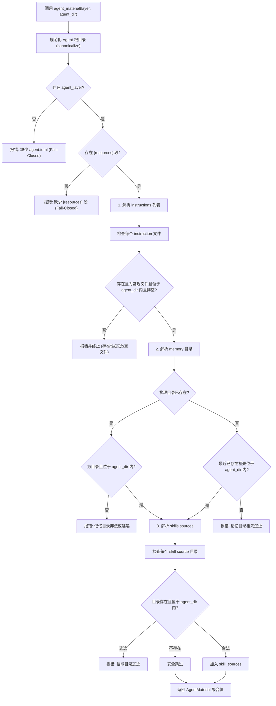

# 02 - Agent 契约与素材路径收敛规范

> **状态**：现行规范（生效日期：2026-10-24）  
> **适用范围**：`pipi-venv`（av / agents）、提示词组装、工具上下文与文件编辑器  
> **参考基准**：`crates/pipi-venv/src/agents/contract.rs`、`crates/pipi-venv/src/av/merge.rs`、`AGENTS.md`、`.zcode/plans/plan-sess_a5b856de-f2d7-475b-8324-957dabfff6c9.md`

---

## 1. 背景与核心设计动机

在早期实现中，Agent 侧的素材路径（如系统指令、长期记忆目录、内置技能来源）大量依赖代码层面的硬编码常量（如 `paths.rs` 中的 `harness_dir`、`join("memory")`）和启发式目录扫描。这种“代码定义路径”的模式带来了诸多结构性缺陷：
1. **灵活性受限**：调整 Agent 内部目录布局需要修改核心代码与重新编译。
2. **越界风险隐匿**：缺乏统一的根包含性校验（Containment Check），符号链接或相对路径可能导致 Agent 状态逃逸。
3. **职责割裂**：提示词装配、记忆读写工具、技能索引与前端文件编辑器各自拼装路径，口径无法保证绝对一致。

**核心决策**：**将 Agent 侧素材的路径权威完全移交给 `agent.toml` 契约（遵循 `av` 规范）**。
- `agent.toml` 是 Agent 内部素材的唯一路径权威；
- 未来若调整存储布局，仅需更新模板与存量契约，**内核组装与调度逻辑保持零修改**。

---

## 2. `agent.toml` 契约与 `[resources]` 显式声明机制

每个 Agent 拥有一个且仅有一个位于其根目录下的契约文件：`~/.pipi/agents/<name>/agent.toml`（与元数据 `agent.json` 同级存放）。

### 2.1 三项显式声明原则（Fail-Closed）

在 Agent 层契约中，`[resources]` 段必须显式声明以下三项素材位置：

```toml
schema = 1

[resources]
instructions = ["harness/AGENTS.md"]  # 1. 显式声明指令文件列表
memory = "harness/memory"             # 2. 显式声明记忆持久化目录

[resources.skills]
sources = ["harness/skills"]          # 3. 显式声明技能来源目录列表
```

- **三项必需性**：
  - `agent.toml` 文件缺失 → **Fail-Closed 立即拒绝**；
  - `[resources]` 段缺失 → **Fail-Closed 立即拒绝**；
  - `instructions`、`memory`、`skills.sources` 三项中任何一项缺席 → **Fail-Closed 立即拒绝**，并在错误信息中输出精准的修复指引与示例配置。
- **显式置空语义**：
  - 如果 Agent 确实不需要某些素材（例如只执行纯任务、无需注入提示词文件的系统 Agent），必须显式声明为空数组：
    ```toml
    [resources]
    instructions = []
    memory = "harness/memory"

    [resources.skills]
    sources = []
    ```
  - 显式声明 `[]` 传达了明确的开发者意图，杜绝因键名遗漏或拼写错误导致的隐蔽失效。

---

## 3. 层级安全隔离：项目层严禁声明 `[resources].memory`

Pipi 支持多层契约合并机制（`Agent` 层 → `Project` 项目层 → `ProjectLocal` 项目本地覆写层）。在环境合并时，**严格禁止非 Agent 层契约声明记忆路径**。

### 3.1 跨仓库安全防护论证

- **攻击面分析**：
  项目层契约（工作区根目录下的 `agent.toml` 或 `agent.local.toml`）通常随代码仓库进行版本控制。如果允许项目层定义 `[resources].memory`：
  1. **恶意仓库篡改记忆根**：克隆不受信任的外部开源仓库时，该仓库可能将 `memory` 路径指向宿主机的敏感路径（如 `~/.ssh` 或项目源码目录），诱导 Agent 在调用 `memory` 工具时覆盖关键系统文件。
  2. **状态污染与泄露**：一个项目的恶意配置可能覆写或偷窥其他项目/Agent 的私有记忆资产。
- **隔离原则**：
  **长期记忆是 Agent 的一等资产与个人状态，与工作区代码完全解耦。** 工作区代码只是 Agent 暂时驻留和作业的环境，决不允许被动克隆的外部仓库拥有支配 Agent 内部记忆存储位置的权力。

### 3.2 机器强制拦截实现

在 `crates/pipi-venv/src/av/merge.rs` 的 `merge_layers` 函数中，对每一层契约实施严格的类型守卫：

```rust
// 截自 crates/pipi-venv/src/av/merge.rs
for layer in layers {
    layer.config.validate()
        .map_err(|e| format!("{} 校验失败：{e}", layer.label))?;

    // 记忆目录是 Agent 的写入位置：项目层文件可能来自克隆的仓库，
    // 声明它等于让仓库决定 Agent 的记忆写到哪里。
    if layer.kind != LayerKind::Agent
        && layer.config.resources.as_ref().is_some_and(|r| r.memory.is_some())
    {
        return Err(format!(
            "{} 不得声明 [resources].memory：记忆目录属于 Agent 定义（项目层不得声明）",
            layer.label
        ));
    }
}
```

任何在项目层包含 `resources.memory` 的行为都会触发硬错误（Hard Error），阻断运行并保障宿主安全。

---

## 4. 单一解析收口：`agent_material`

为了杜绝各模块自行拼接路径导致的安全隐患与口径漂移，工作区设立了唯一的解析门面函数：
`pipi_venv::agents::contract::agent_material`。

### 4.1 数据结构

```rust
/// 声明的一条指令文件：规范化路径 + 正文缓存
#[derive(Debug, Clone)]
pub struct AgentInstruction {
    pub path: PathBuf,
    pub content: String,
}

/// Agent 侧提示词素材聚合体（三项权威）
#[derive(Debug, Clone)]
pub struct AgentMaterial {
    /// 声明的指令文件（按声明顺序排列；保证存在、为常规文件、位于 Agent 目录内、非空）
    pub instructions: Vec<AgentInstruction>,
    /// 记忆目录（绝对路径；保证未逃逸 Agent 目录；允许物理目录尚未创建）
    pub memory_dir: PathBuf,
    /// 技能来源目录列表（绝对路径；已校验位于 Agent 目录内；不存在时安全跳过）
    pub skill_sources: Vec<PathBuf>,
}
```

### 4.2 校验不变量与解析流程

`agent_material(agent_layer: Option<&Layer>, agent_dir: &Path) -> Result<AgentMaterial, String>` 的执行遵循以下不可突破的不变量：



1. **绝对路径逃逸防御（Containment Check）**：
   - 所有的指令路径、记忆目录、技能源目录在解析后均经过 `fs::canonicalize` 解析真实符号链接，并以 `starts_with(&agent_dir)` 强制校验。
   - 无论是通过 `../` 向上越界、`~` 家目录逃逸还是符号链接跨目录跳跃，一律 Fail-Closed 拦截并报错。
2. **存在性与容错语义分层**：
   - **指令文件（`instructions`）**：必须物理存在、必须为常规文件（Regular File）、内容不得为空。任何一项不满足立即拒绝。
   - **记忆目录（`memory`）**：
     - 若物理目录已存在：必须为常规目录且不逃逸。
     - 若物理目录尚未创建：调用 `canonicalize_existing_ancestor` 递归检查其最近的现存祖先目录，确保该路径落点绝不脱离 `agent_dir`；允许运行时按“空记忆”继续推进，由 `memory` 工具在首次执行写入时安全建目录。
   - **技能来源（`skills.sources`）**：若声明的技能目录尚不存在，采取静默跳过策略（与第三方技能包生命周期对齐）；但若存在，则必须受 Agent 目录包含性守卫约束。

---

## 5. 默认模板与生态消费收敛

### 5.1 默认模板：`DEFAULT_AGENT_CONTRACT`

在整个 Rust 代码库中，硬编码字面量 `"harness"` **仅且仅被允许出现在一个地方** —— 即新建 Agent 时的默认骨架模板常量：

```rust
// 截自 crates/pipi-venv/src/agents/contract.rs
pub const DEFAULT_AGENT_CONTRACT: &str = "\
schema = 1

[resources]
instructions = [\"harness/AGENTS.md\"]
memory = \"harness/memory\"

[resources.skills]
sources = [\"harness/skills\"]
";

pub const DEFAULT_HARNESS_DIR: &str = "harness";
```

- 该模板供 `create_agent`（创建新 Agent）与技能启用初始化骨架共用。
- `"harness/"` 是默认值，**不是系统权威**。若用户或组织在 `agent.toml` 中将 `memory` 声明为 `notes/memory`，系统将完全尊重契约配置。

### 5.2 消费端全面收敛

工作区内所有需要获取 Agent 素材的子系统全部统一由契约解析结果驱动：

| 消费子系统 | 代码落点 | 消费方式与行为保证 |
| :--- | :--- | :--- |
| **提示词装配** | `crates/pipi-venv/src/prompt/mod.rs` | 仅从 `AgentMaterial.instructions` 读取正文并拼接注入系统提示词；从 `AgentMaterial.memory_dir` 读取并构建记忆索引。 |
| **工具上下文构建** | `crates/pipi-venv/src/agents/tool_context.rs` | `ToolContext.memory_dir` 严格指向 `AgentMaterial.memory_dir`；`ToolContext.trusted_read_roots` 聚合 `memory_dir` 与 `skill_sources`。 |
| **文件编辑器** | `crates/pipi-venv/src/agents/files.rs` | 可编辑文件列表严格限定为：声明的 `instructions` 文件 ∪ `memory_dir` 下的 `.md` 文件；相对路径由契约反推。 |
| **宿主 IPC 契约** | `crates/pipi-core/src/commands.rs` | `list_agent_files` 命令返回类型为 `{ files: Vec<String>, memoryPrefix: String }`，前端编辑器根据 `memoryPrefix` 自动为新建记忆前缀归档目录。 |

### 5.3 契约与 `agent.json` 策略的正交性

必须明确区分 `agent.toml` 契约与 `agent.json` 的 `systemPrompt` 策略：
- **`agent.toml` 决定「每一项素材物理存放在哪里」**；
- **`agent.json.systemPrompt`（`both` / `agent` / `workspace` / `none`）仅决定「哪一侧的素材参与注入系统提示词」**。
- **正交保证**：即使 `systemPrompt` 配置为 `workspace` 或 `none`（不向模型注入 Agent 侧指令），Agent 内部的 `memory` 读写工具、权限沙箱、技能根与文件编辑器依然完整受 `agent.toml` 契约规范并正常可用。

---

## 6. 不变量与测试矩阵

在维护 Agent 契约与素材解析逻辑时，必须确保以下不变量与测试用例全绿：

1. **契约必需性矩阵测试**：
   - 缺少 `agent.toml` 时启动失败；
   - 缺少 `[resources]` 段时启动失败；
   - 缺少 `instructions` / `memory` / `skills.sources` 任一项时启动失败并提示补全语法。
2. **安全逃逸矩阵测试**：
   - 尝试通过 `../../etc/passwd` 引用指令文件时被拒；
   - 尝试通过外部软链接指向记忆目录时被拒；
   - 项目层试图声明 `[resources].memory` 时在 `merge_layers` 中被拒。
3. **自定义路径透明性测试**：
   - 将 `memory` 显式配置为 `custom_dir/my_memory`，验证 `memory` 工具、提示词注入与文件编辑器是否无缝同步指向新目录。
