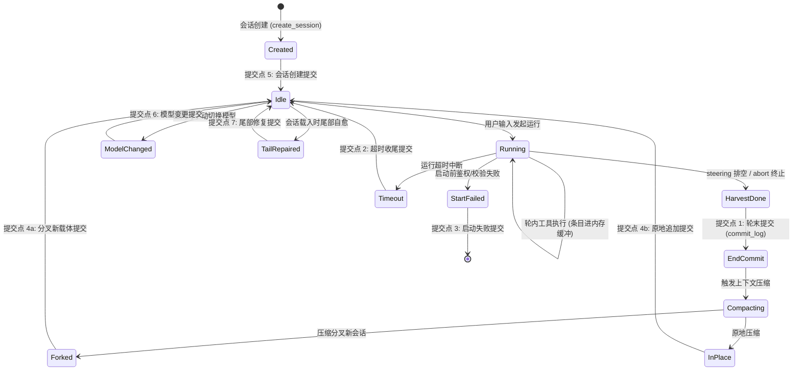
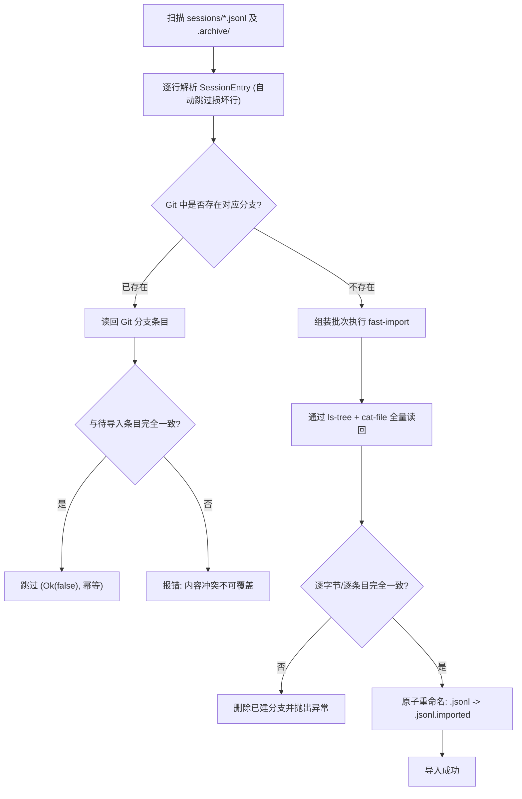

# 03 - Git 分支会话载体设计与实现规范

> **状态**：现行规范（生效日期：2026-10-24）  
> **适用范围**：`pipi-session`、`pipi-agent::session` 提交点调度、会话导入与生命周期  
> **参考基准**：`docs/git-session-store.md`、`crates/pipi-session/src/git/`、`AGENTS.md`、`.zcode/plans/plan-sess_ab4582ae-ee65-44ec-818f-6019c6446274.md`

---

## 1. 背景与选型论证

在 Pipi 早期版本中，会话持久化采用单 JSONL 文件追加模型。随着系统演进，纯文本追加暴露了严重的结构瓶颈：
1. **压缩开销大**：历史会话压缩（Compaction）需要全量重写新文件并物理复制历史段落，产生巨大磁盘写入与碎片（实测一次压缩分叉落盘近 10MB）。
2. **缺乏版本与分支语义**：无法原生表达“从某条消息分叉”或“撤销最近一轮”，回溯与时光倒流难以零成本实现。
3. **生态割裂**：专有文件格式无法直接借助成熟的标准开发者工具进行检查、比对（Diff）、分支图谱查看或打包分发。

### 1.1 为什么 Git 分支是唯一的持久化载体？

Pipi 坚持 **“一切皆文件”** 与 **“本地优先”** 的系统哲学，明确拒绝引入 SQLite 或私有二进制数据库。经详尽的工程实测（基于包含 1472 条条目、4.88 MB 的超大会话基准测试），Git 成为唯一默认的会话载体：

| 维度 | 传统 JSONL 载体 | Git 分支载体 (`sessions.git`) |
| :--- | :--- | :--- |
| **压缩/分叉成本** | 需全量反序列化、写新文件、归档原文件（耗时 27ms，落盘 9.76MB） | **零复制创建新分支**（`update-ref` 仅需 1.1ms，0 字节增量） |
| **磁盘存储利用率** | 1.00×（基线，4.88 MB） | **0.62×**（3.01 MB，得益于 pack delta 压缩与对象复用） |
| **可观测性** | 需手写脚本解析 JSON 行 | 直接使用 `git log`、`git show`、`git diff` 浏览交互历史 |
| **生态共享与分发** | 需开发专有格式导入导出工具 | 原生支持 `git bundle create`、`git push`、`git fetch` |
| **回滚与撤销机制** | 破坏性裁剪原文件或软删除标记 | 分支 HEAD 移动与保存，可回溯兄弟分支 |

---

## 2. 存储数据模型与物理布局

### 2.1 影子裸仓库（Shadow Bare Repository）

为确保绝不污染用户项目的版本控制，会话 Git 仓库作为独立裸仓库（Bare Repository）存放在 Agent 的数据目录内：

```text
~/.pipi/agents/<name>/sessions.git/         # 独立裸仓库 (git init --bare --initial-branch=main)
  refs/heads/session/<session-id>           # 活跃会话分支 (压缩或分叉后生成新分支)
  refs/heads/archive/<session-id>           # 归档会话分支 (对应历史归档区)
  refs/heads/main                           # 自述锚提交 (保证 git log 默认可用)
```

- **Session ID 契约不变**：仍沿用 `{timestamp_millis}-{uuid}` 格式，作为分支名的后缀。前端展示与排序依然从 ID 的前缀解析起始时间。

### 2.2 Tree 对象与文件命名：一条 Entry 一个文件

每个 Git Commit 包含一棵 Git Tree，会话中的每条条目（`SessionEntry`）对应 Tree 中的一个独立 JSON 文件：

```text
e/<3位分片>/<seq:05>-<kind>-<id8>.json
```

- **分片规则**：`shard = entry.seq / 1000`（按千条分片，格式化为 3 位数字，如 `e/000/`、`e/001/`）。
- **零填充序列号（`seq:05`）**：保证在 Git Tree 内部**按文件名排序与按会话时间序列完全等价**。读回历史时直接通过 `ls-tree -r` 流式读取，无需拓扑排序解析 DAG。
- **类型与前缀**：`kind` 取自条目类型（`message`、`custom`、`compaction`、`model_change`、`env`），`id8` 为条目 UUID 的前 8 位。
- **逐字节等价性**：文件内容即为原 JSONL 中序列化的那一行 JSON 原文（含换行符）。反序列化直接复用 `SessionEntry` DTO。

### 2.3 Commit 规范与轮级可读性

每个 Commit 均包含精心设计的人类可读元数据：
- **Subject**：该轮首条用户输入（截断至 72 字符）或事件摘要（如 `assistant: ...`、`compaction: llm-summarize`），使 `git log --oneline` 成为纯文本会话浏览器。
- **Body Trailer**：包含 `Turn: <n>` trailer（轮次号）。轮号按内核提交点严格递增，支持通过 `git log --grep='Turn: 12'` 精确提取指定单轮交互。
- **Author / Committer**：Author 记录为 `<role> <role@pipi.local>`（如 `user <user@pipi.local>`），Committer 记为 `Pipi <pipi@local>`，提交时间精确映射为条目时间戳。

---

## 3. O2 提交模型与 fast-import 性能优化

### 3.1 提交模型决策对比

在会话与 Commit 的映射粒度上，设计方案进行了深入的对比权衡：

| 模型方案 | 特点与实测指标 | 为什么采用或否决 |
| :--- | :--- | :--- |
| **O1：每条 Entry 一个 Commit** | 1472 条条目生成 1472 个 Commit | **否决**：提交粒度过细，单轮中产生大量碎片 Commit，浏览体验琐碎。 |
| **O3：输入提交一次 + 产物提交一次** | 1472 条条目生成 112 个 Commit | **否决**：产生大量未配对的半轮中间状态，撤销回退边界模糊。 |
| **下一次输入到来时提交** | 提交点延迟到下一轮输入时 | **坚决否决**：严重持久化倒退！异常崩溃或直接关窗会丢失用户刚看完的最后一轮；新会话在仓库内不可见。 |
| **O2：轮末提交该轮全部条目** | 1472 条条目生成 56 个 Commit | **正式采用**：一轮一个 Commit，精准对齐用户“一次对话输入对应一个提交”的心智模型；撤销操作自然对齐至 `tip^`。 |

### 3.2 `git fast-import` 流式写入优化

条目在运行过程中首先写入内存缓冲（`GitSink`），在提交点通过单一进程管道批处理固化：
1. **管道组装**：通过标准输入一次性注入当前批次的全部对象：
   - 若干个 `M 100644 inline e/...` 描述与对应 JSON 数据流（创建 Blob）；
   - 单个 `commit` 指令、Author/Committer、Commit Message 及 `from <parent>` 引用；
   - 管道末尾追加 `done` 指令。
2. **极速写入**：实测每条 entry 写入耗时仅 **0.27 ms**，典型一轮交互（中位数 14 条条目）提交仅需 **~6 ms**，彻底消除主循环等待开销。
3. **节流 GC**：提交成功后，由后台基于互斥锁执行带节流控制的 `git gc --auto`（间隔 ≥60s），有效收敛小 pack 与松散对象。

---

## 4. 内核定义的 7 大提交点

提交时机**绝对不属于存储层自决**，而是由 L5 单会话内核（`pipi-agent::session`）集中调度控制。内核严格在以下 7 个关键切面触发提交：



### 4.1 提交点明细剖析

| 编号 | 提交点场景 | 代码落点 | 执行时机与技术约束 |
| :--- | :--- | :--- | :--- |
| **1** | **轮末提交 (Turn End)** | `pipi-agent/src/session/run.rs` | `harvest` 返回后、`run_compaction` 之前、**运行守卫释放之前**、`AgentEnd` 事件发出之前。必须在阻塞线程池（`tokio::task::spawn_blocking`）异步执行。 |
| **2** | **超时终止 (Timeout)** | `pipi-agent/src/session/run.rs` | 超时分支退出前，在 `ledger::append_terminal` 追加终态后立即提交，确保半配对批次不遗失。 |
| **3** | **启动失败 (Start Failure)**| `pipi-agent/src/session/run.rs` | `fail_start` 记录错误终态时同步提交，防止会话落盘状态悬空。 |
| **4** | **压缩条目 (Compaction)** | `pipi-agent/src/session/compaction.rs` | **分叉路径**：在 `mem::replace` 替换内存账本前对新会话（`forked`）提交首个 Commit；**原地路径**：直接追加记录并提交。 |
| **5** | **会话创建 (Creation)** | `pipi-core/src/runtime/slots.rs` | 会话初始化写入 `env` 与初始 `model_change` 后立即提交，确保空会话在列表与 Git 引用中立即可见。 |
| **6** | **空闲切模型 (Model Change)**| `pipi-agent/src/session/state.rs` | 空闲时调用 `set_model`，在追加变更条目后同步提交。 |
| **7** | **异常尾部修复 (Tail Repair)**| `pipi-agent/src/session/state.rs` | 打开会话时若执行了 `settle_unanswered_tail` 补齐缺失工具结果，立即固化提交。 |

### 4.2 缓冲容错自愈语义（Self-Healing Buffer）

提交操作允许失败。若系统因偶发进程拥堵导致 Git 进程非零退出：
- **条目安全保留在内存缓冲中**，内存流水号（`seq`）与状态机不向前滑动。
- 本轮会话**不报错中断**，下一次交互到达提交点时，缓冲内的未提交条目将与新条目一道被合并打包至下一次 Commit。

---

## 5. 会话生命周期与 Git 原生操作映射

```
                                  [session/A] (旧会话分支)
                                 /
(main锚点) ──●───●───● (压缩点) ───● (新压缩线)
                                 \
                                  [archive/A] (归档迁移引用)
```

1. **会话压缩（Compaction）**：
   - 原理：基于当前分支的 Tip 提交，通过 `update-ref` 毫秒级创建新分支 `refs/heads/session/<new-id>`。
   - 优势：**零数据复制**，前序历史对象的 Pack Blob 完全共享；旧会话分支可保留或迁至 `archive/`。
2. **会话分叉（Fork）**：
   - 从指定历史条目所在的 Commit 创建新分支，瞬时完成且完全无物理增量。
3. **撤销最近一轮交互（Undo / Revert）**：
   - 在 O2 模型下，最近一轮完整的交互对应单个 Commit；撤销仅需将分支 HEAD 移动至 `tip^`，被撤销的交互线可选择性保存为 `archive/<id>-reverted-<ts>`，兼具**零复制与完全可回溯性**。
4. **会话归档与恢复**：
   - 仅涉及 Git Ref 重命名（`refs/heads/session/<id>` ↔ `refs/heads/archive/<id>`），无文件系统移动开销。
5. **彻底删除（Delete）**：
   - 执行 `update-ref -d` 删除分支引用，随后执行 `git gc --prune=now` 立即物理回收该会话独占的对象。

---

## 6. 历史 JSONL 会话幂等导入机制

为了平滑迁移旧版本机器上的会话，系统提供了无损的显式导入通道：

### 6.1 导入命令与实现

- **入口**：宿主 IPC 命令 `import_sessions`（工作台文件管理页）以及无外壳命令行工具：
  ```bash
  cargo run -p pipi-session --example import_legacy_sessions
  ```
- **核心实现**：`crates/pipi-session/src/legacy.rs` 的 `import_legacy_sessions`。

### 6.2 导入校验步骤



1. **容错读取**：通过 `load_session` 逐行读取，遇到损坏残缺行记录告警并跳过，绝不阻塞整体迁移。
2. **读回校验**：写入 Git 后，强制通过 `read_session` 全量读回并与原条目逐一比对。若有任何偏差，立刻回滚删除分支并报错中断。
3. **原子重命名**：只有在百分之百比对一致后，原文件才被原子重命名为 `.jsonl.imported` 保留作为终极备份。
4. **幂等性保障**：若目标分支已存在且内容一致，则直接返回 `Ok(false)`（跳过），允许重复执行导入。

---

## 7. `pipi-session` 职责与进程调用隔离边界

工作区对进程派生施加了严格的安全与架构隔离：

1. **唯一性守卫**：
   - **`pipi-session` 是全工作区唯一允许为会话存储持久化 spawn `git` 进程的 crate**。
   - 宿主 `pipi-core` 与内核 `pipi-agent` 严禁直接调用标准库 `Command::new("git")`。
2. **纯原生与零私有依赖**：
   - 会话载体完全通过系统标准 `git` 命令行进行无头操作，严禁引入 `git2`（libgit2 C 绑定）以防跨平台编译污染与内存漏洞。
3. **环境加固与并发安全**：
   - `crates/pipi-session/src/git/exec.rs` 在派生进程时强制净化环境变量，避免调用受用户外部配置污染。
   - 仓库内部持有进程级 `Mutex<()>`，严格隔离写操作与后台自动 GC，杜绝多线程写引用竞争。
