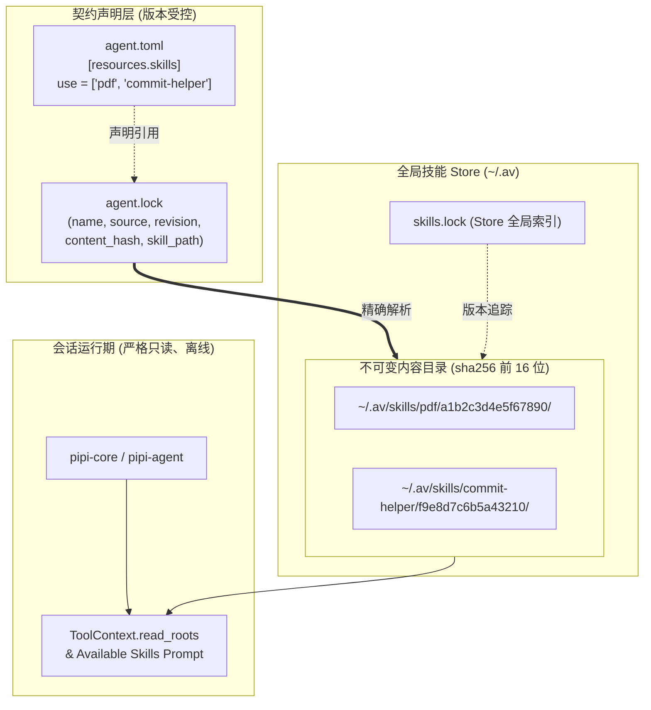

# 04 - av 技能生态架构规范：全局 Store、锁机制与供应链安全

> **状态**：生效中  
> **所属层级**：`crates/pipi-venv` (av 域) / 契约层与技能包管理  
> **权威实现**：`crates/pipi-venv/src/av/` (`store.rs`, `sources.rs`, `skills.rs`, `paths.rs`, `cli/`)  
> **前置规范**：`01-workspace-architecture.md`, `02-agent-contract-and-materials.md`

---

## 1. 背景与设计定位

早期 Pipi 的技能（Skills）依赖简单的本地目录扫描，缺乏版本确定性、全局共享复用能力以及严格的供应链安全防护。当不同 Agent 或项目依赖不同修订版本的技能包时，极易发生覆盖冲突或环境漂移。

为此，Pipi 引入了 **av 技能生态系统**（借鉴 Python 生态 `uv` 与 Rust 生态 `cargo` 的优秀设计哲学），将 `av` 从最初的「只读契约校验工具」升级为「**Agent 环境契约 + 声明式技能包管理引擎**」：
1. **统一存储与内容寻址**：技能安装到全局 Store（`~/.av/skills/`），基于 SHA-256 内容寻址，支持同名多版本并存且发布后不可变。
2. **声明与锁定解耦**：在 `agent.toml` 中仅显式声明所需技能（`use = [...]`），由同目录的 `agent.lock` 提供可复现的精确锁定。
3. **严格的离线与安全不变量**：会话启动严格离线且只读；缺锁或缺内容即 Fail-Closed；强制校验目录穿透、符号链接与内容限额。



---

## 2. 核心设计原则与关键语义

### 2.1 安装 ≠ 启用（Install vs Enable）
- **`av skill install`**：仅负责拉取技能内容并发布到全局 Store（`~/.av/skills/<name>/<hash16>/`），此时技能对任何 Agent 均**未启用**。
- **`agent.toml` 的 `use` 声明**：只有在契约中显式声明 `[resources.skills] use = ["<name>"]` 时，该技能才会被对应 Agent 激活并加载进上下文。
- 绝不隐式全局生效，杜绝环境污染。

### 2.2 声明与锁定分离（Declaration vs Lock）
- **`agent.toml`（用户意图）**：声明意图清单，如 `use = ["pdf"]`。
- **`agent.lock`（机器解析事实）**：记录该技能解析出的确切来源 URL、Git commit（40 位 SHA-1/SHA-256）、子目录路径以及精确的 `content_hash`。
- 锁定机制确保了团队协作与跨机器克隆时的 100% 行为一致性与可复现性。

### 2.3 会话启动严格离线且只读（Offline & Read-Only Runtime）
- 会话启动加载技能时（`resolve_declared_skills`），**严禁发起任何网络请求**。
- 运行时按层级向上查找 `agent.lock`，若发现以下任何一种异常，**一律 Fail-Closed（拒绝启动并明确提示运行 `av skill sync`）**：
  1. `agent.toml` 声明了技能，但同级目录缺少 `agent.lock`；
  2. `agent.lock` 缺少声明技能的条目；
  3. `agent.lock` 记录的 `content_hash` 在 `~/.av/skills/` 中不存在对应内容目录；
  4. 技能目录内的 `SKILL.md` 丢失或 frontmatter 校验失败；
  5. 技能路径逃逸出 Store 根目录。

---

## 3. 全局 Store 布局与内容寻址

### 3.1 目录结构与规范
全局 Store 位于 `<av_home>`（默认 `~/.av/`，可通过环境变量 `AV_HOME` 覆盖以支持测试隔离与沙箱部署）：

```text
~/.av/
├── skills.lock                       # 全局 Store 索引：记录本机已安装的所有技能版本与时间戳
├── .tmp/                             # 原子安装暂存目录（与 store 处于同一文件系统挂载点）
└── skills/
    └── <skill-name>/                 # 技能名称（与 SKILL.md 的 name 对齐）
        ├── <hash16>/                 # 内容 SHA-256 前 16 位十六进制字符（不可变内容根）
        │   ├── SKILL.md              # 规范技能元数据与指令说明
        │   ├── scripts/              # 辅助执行脚本（如有）
        │   └── references/           # 参考文档（如有）
        └── <another_hash16>/         # 另一版本并存目录（不同项目锁定不同版本互不冲突）
```

### 3.2 内容哈希算法与不可变性
1. **哈希计算范围**：遍历技能目录下的所有有效文件（跳过 `.git` 目录，剔除特殊文件）。
2. **规范格式**：`sha256:<64 位小写十六进制>`。
3. **目录命名**：取该哈希值去除 `sha256:` 前缀后的**前 16 位**字符作为目录名（`CONTENT_DIR_NAME_LEN = 16`）。
4. **发布后不可变**：一旦写入 `~/.av/skills/<name>/<hash16>/`，该目录即被视作只读资产。任何文件修改都会导致哈希校验失败（由 `av skill verify` 检举）。

### 3.3 原子发布机制
为了防止并发安装或网络中断导致 Store 出现半写入的破损状态：
1. 技能文件先拉取并解压至临时工作目录（位于 `~/.av/.tmp/<uuid>`）。
2. 计算全量内容哈希，确认无安全违规后，执行最终校验。
3. 使用同文件系统原子的 `fs::rename` 将其移入目标 `~/.av/skills/<name>/<hash16>/`。
4. 若目标目录已存在，则表明该确切版本已被安装，直接安全清理暂存目录即可。

---

## 4. 锁文件机制（`agent.lock`）

### 4.1 数据模型与格式
`agent.lock` 采用标准的 TOML 格式，与声明它的 `agent.toml` 存放在同一目录下：

```toml
version = 1

[[skills]]
name = "pdf"
source = "https://github.com/earendil-works/skills"
source-type = "git"
ref = "main"
revision = "4a3b2c1d0e9f8a7b6c5d4e3f2a1b0c9d8e7f6a5b"
skill-path = "skills/pdf"
content-hash = "sha256:a1b2c3d4e5f67890123456789abcdef0123456789abcdef0123456789abcdef0"

[[skills]]
name = "local-helper"
source = "/absolute/path/to/my-tools/skills/local-helper"
source-type = "local"
content-hash = "sha256:b2c3d4e5f6a1b2c3d4e5f6789abcdef0123456789abcdef0123456789abcdef0"
```

### 4.2 字段完整性约束
- `version`：当前固定为 `1`。
- `name`：符合 `[a-z0-9-_]+` 规范的技能标识符。
- `source-type = "git"`：
  - 必须提供 40 位十六进制的 commit 哈希作为 `revision`（不允许使用浮动的分支名或短 SHA）。
  - `ref` 可选，记录解析时对应的原始分支/标签。
- `source-type = "local"`：
  - `source` 必须是标准的绝对路径。
  - 严禁包含 `revision`（本地源以 `content_hash` 作为唯一内容身份）。
- `content-hash`：完整的 64 位小写十六进制 SHA-256。

---

## 5. 供应链安全与防护边界

在技能生态中，外部引入的技能文件属于不可信输入，`crates/pipi-venv/src/av/` 实现了多道严格的安全防御：

| 防护维度 | 约束规则 | 违规处置行为 |
| :--- | :--- | :--- |
| **符号链接逃逸** | `scan_skill_content` 拒绝任何符号链接（Symlink）、FIFO、Socket、设备节点 | 拒绝安装 / 拒绝解析（Fail-Closed 报错） |
| **文件数量配额** | 单个技能包文件总数上限 `MAX_SKILL_FILES = 500` | 超过直接中止安装并清理暂存 |
| **存储体积配额** | 单个技能包总解压体积上限 `MAX_SKILL_BYTES = 5 MiB` (5,242,880 字节) | 超过直接中止安装并清理暂存 |
| **VCS 元数据隔离** | 扫描与哈希计算时跳过 `.git` 目录及其内容 | 确保 VCS 内部状态不污染技能内容指纹 |
| **路径穿透逃逸** | 内容解析时校验 `canonicalize(entry_dir).starts_with(canonicalize(store_root))` | 若发生目录穿透，强制 Panic/Error 拒绝启动 |
| **沙箱读取授权** | 声明并解析成功的技能目录自动注入 `ToolContext.read_roots` | 仅授权只读工具读取，写工具受工作区边界隔离 |

---

## 6. CLI 工具链：`av` 子命令

`av` CLI 是技能包生态的官方管理工具，所有输出均遵循一致的错误码与参数规范（退出码 `0` 成功，`1` 失败并以 `av: <error>` 输出至 stderr）：

### 6.1 契约静态校验与诊断
```bash
av check [dir]                # 校验 agent.toml 语法、白名单、requires 与技能锁定一致性
av env [dir] [--json]         # 打印最终注入的子进程环境变量（敏感信息自动脱敏）
av doctor [dir]               # 实测 requires 工具的系统存在性与版本
```

### 6.2 技能包管理命令群 (`av skill ...`)
- **`av skill search <query> [--limit N] [--json]`**：
  从公网生态（skills.sh）查询技能包，返回 `owner/repo` 短名与描述。
- **`av skill install <spec> [--skill <name>]... [--all] [--dry-run]`**：
  仅拉取并安装到全局 Store（不修改当前目录的契约与锁文件）。
  支持源格式：`owner/repo[@ref][#subpath]`、Git 完整 URL、本地目录路径（`./`、`../`、`~/` 等）。
- **`av skill add <spec> [--skill <name>]... [--all] [--contract file] [--replace] [--dry-run]`**：
  组合执行：安装至 Store + 使用 `toml_edit` 保留格式地向 `agent.toml` 的 `use` 数组追加技能名 + 更新 `agent.lock`。
- **`av skill sync [dir] [--dry-run] [--repair] [--yes]`**：
  依据 `agent.toml` 的 `use` 与 `agent.lock` 的条目，将缺失的技能物化至 Store（新克隆项目恢复开发环境的核心命令）。
- **`av skill list [--declared] [--json]`**：
  查看当前全局 Store 中已安装的技能版本；加上 `--declared` 仅显示当前契约声明的技能。
- **`av skill verify [name]... [--declared] [--json]`**：
  重新遍历计算本地文件内容哈希，检测 Store 中的文件是否发生非预期的漂移或篡改。
- **`av skill update [name]... [--contract file] [--dry-run]`**：
  重新向远端 Git 解析最新 revision 并拉取最新内容，原子更新 `agent.lock`。
- **`av skill remove <name> [--purge] [--contract file] [--yes]`**：
  从契约与锁文件中移除声明；若附带 `--purge` 则同时从全局 Store 中物理删除对应版本。

---

## 7. 架构落点与代码映射

```text
crates/pipi-venv/src/av/
├── mod.rs                    # av 模块门面定义
├── paths.rs                  # AV_HOME、PIPI_HOME 及 skills 存储路径计算
├── schema.rs                 # agent.toml 规范定义，含 SkillsFilter.use 校验
├── merge.rs                  # 契约分层继承逻辑（use 数组的高层完全替换策略）
├── skills.rs                 # SkillMeta、SKILL.md frontmatter 解析与发现规则
├── store.rs                  # 全局 Store 寻址、agent.lock / skills.lock 读写与 resolve_declared_skills
├── sources.rs                # 来源规格解析（Git / 本地目录）、git 浅取与生态仓库内部发现
├── install.rs                # 原子安装、更新、同步与卸载业务流
├── contract_edit.rs          # toml_edit 无损编辑 agent.toml 保留注释与缩进
├── net.rs                    # 技能检索 HTTP 客户端（仅在 search feature 开启时生效）
└── cli/
    ├── mod.rs                # CLI 参数分发与解析入口
    ├── contract.rs           # check / env / doctor 子命令实现
    └── skill.rs              # skill search/install/add/sync/list/verify/update/remove 子命令实现
```

---

## 8. 测试与质量保证

1. **内容哈希与不可变性回归**：`crates/pipi-venv/src/av/store.rs` 内联单测覆盖内容篡改、目录命名长度、版本覆盖保护。
2. **供应链防御测试**：单测覆盖符号链接拒绝、文件数超 500 拒绝、体积超 5MB 拒绝、跳过 `.git` 逻辑。
3. **本地 Git 端到端集成测试**：`crates/pipi-venv/tests/skill_lifecycle.rs` 通过本地裸仓库模拟 Git 拉取、更新、锁定、同步全链路（杜绝网络依赖，确保离线 CI 稳定）。
4. **锁文件一致性测试**：断言缺少 `agent.lock` 时会话启动 Fail-Closed，并在提示信息中包含引导命令 `av skill sync`。
