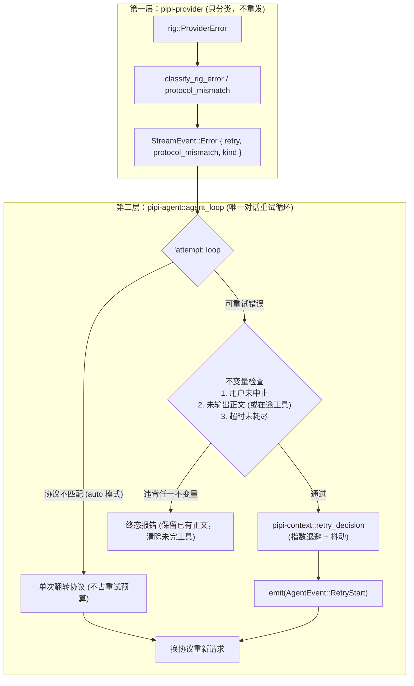

# 05 - 请求重试与运行时协议协商规范

> **状态**：生效中  
> **所属层级**：`crates/pipi-provider`（分类与协商）/ `crates/pipi-context`（退避算法）/ `crates/pipi-agent`（循环控制）  
> **权威实现**：  
> - `crates/pipi-provider/src/classify.rs`（rig 错误分类、协议不匹配识别）  
> - `crates/pipi-provider/src/lib.rs`（`effective_api`, `LEARNED_PROTOCOLS` 记忆）  
> - `crates/pipi-context/src/retry.rs`（`RetryPolicy`, `retry_decision`, 指数退避与抖动）  
> - `crates/pipi-agent/src/agent_loop/stream.rs`（对话重试循环、在途工具清理、协议翻转）  
> **前置规范**：`01-workspace-architecture.md`

---

## 1. 背景与核心目标

在 LLM 应用中，网络波动、服务端限流（429）、网关临时故障（5xx）以及模型接入协议不一致是常见的常态化异常。若在架构中处理不当，极易带来以下严重问题：
1. **多层重试放大**：若底层 HTTP 客户端与上层 Agent 循环各自重试，3 次请求会放大为 9 次甚至 27 次，迅速耗尽配额或让用户误以为进程假死；
2. **文本重复流出**：若模型已吐出部分正文文本后再重试，会导致前端重复追加多份截断的正文，破坏会话历史；
3. **残缺工具调用执行**：若在工具参数吐出一半时网络中断，盲目将半截 JSON 交付执行会触发不可逆的工具副作用（如错误的 bash 命令或残缺写入）；
4. **多模型协议冲突**：现代聚合网关（如 OpenCode、OneAPI）同一端点下混用不同协议，若以 provider 级固定协议请求，会导致特定模型报 400 `ModelProtocolUnsupported`。

本规范确立了 Pipi 的**两层重试架构**与**运行时自愈式协议协商机制**。

---

## 2. 两层重试架构

为了彻底消除双层重试放大风险，Pipi 明确规定职责分离：



### 2.1 第一层：`pipi-provider`（错误归一与分类）
- **禁止在 provider 层进行 HTTP 级自动重试**。
- 基于 `rig 0.43` 的结构化错误类型进行纯函数映射，提取服务端建议的 `Retry-After`，产出 `(RetryVerdict, Option<RetryHint>)`。
- 识别协议不匹配事实（400 状态码 + `ModelProtocolUnsupported`）。

### 2.2 第二层：`pipi-agent::agent_loop`（唯一对话重试循环）
- 会话对话主路径上的**唯一重试点**位于 `stream_assistant_response` 内的 `'attempt: loop`。
- 统筹会话状态、用户打断信号（`AbortSignal`）、正文可见性与在途块，决定重发、翻转协议还是收尾。
- 上下文压缩摘要（`compaction::llm`）独立共用同一套分类与退避策略，但由于其在后台攒批、无界面增量，天然具备整次安全重试的特性。

---

## 3. 错误分类规则表

`crates/pipi-provider/src/classify.rs` 维护全局统一的错误分类矩阵，宁可终态拒绝，绝不猜测无把握的重试：

| 错误来源与特征 | 分类判定 | `RetryHint` 携带内容 | 说明与处理 |
| :--- | :--- | :--- | :--- |
| **HTTP 408 / 409** | **可重试** (`Retryable`) | 默认或从响应头提取 | 网络超时或冲突，短时间后可自愈 |
| **HTTP 429 (常规限流)** | **可重试** (`Retryable`) | 提取 `Retry-After`（秒级转毫秒） | 速率受限，严格尊重服务端等待时间 |
| **HTTP 429 (`insufficient_quota` / `billing`)** | **终态** (`Terminal`) | `None` | 账户余额不足或配额耗尽，重试无意义 |
| **HTTP 500..=599** | **可重试** (`Retryable`) | 默认或从响应头提取 | 服务端网关临时异常（502/503/504） |
| **HTTP 400 (`ModelProtocolUnsupported`)** | **终态**（重试视角） | `None` (带 `protocol_mismatch: true`) | 协议不匹配，交给协议协商逻辑，不占重试预算 |
| **HTTP 400 (上下文超限 `context_length_exceeded`)** | **终态** (`Terminal`) | `None` | 上下文超限属于结构性问题，交由压缩机制处理 |
| **HTTP 401 / 403 / 404 / 413 / 422** | **终态** (`Terminal`) | `None` | 鉴权失败、资源不存在或请求不合法 |
| **网络层断开 (`StreamEnded` / `Truncated`)** | **可重试** (`Retryable`) | `RetryHint::plain()` | 代理中间断流或连接意外重置 |
| **无进展超时 (Idle Timeout, 300s)** | **可重试** (受限) | `RetryHint::timeout()` | 最多只允许额外重试 1 次 |

---

## 4. 重试核心不变量

在 `pipi-agent::agent_loop::stream` 决定是否发起重试时，必须**严格无例外遵守以下四条核心不变量**：

### 不变量 1：用户中止永远不可重试
- 一旦用户点击停止按钮触发 `AbortSignal`，当前尝试立即中止，返回 `StopReason::Aborted`。
- 退避等待过程必须使用 `tokio::select!` 监听 `abort.wait_aborted()`，确保用户在等待期间点击停止能够**毫秒级立即响应**。

### 不变量 2：已输出正文（Prose）绝不重发
- 若当前轮次已流式接收到 `TextDelta` 或 `ThinkingDelta`（即 `prose_visible == true`），说明用户界面已经渲染出可见内容。
- **一旦正文可见，任何后续失败一律禁止自动重试**。直接按终态中断报错（UI 展示保留已有正文，并标注中断原因），防止重试导致界面出现重复或拼接混乱的文本。

### 不变量 3：在途工具调用（Partial Tool Call）为特例允许重发
- 若当前轮次**仅流出工具调用片段**（`ToolCallDelta`）而尚未输出任何正文（`prose_visible == false`），则**允许自动重试**。
- **安全前置动作**：在开启下一次重试前，清空局部积累的 `blocks`，完全丢弃半截工具调用数据。**绝不允许将未完全闭合、未通过 JSON 校验的工具参数交付本地执行工具**。

### 不变量 4：无进展超时最多额外重试 1 次
- 模型无进展超时（默认 300 秒）耗时昂贵。
- 策略规定：`hint.idle_timeout == true` 时，总失败次数达到 2 次即判定 `GiveUpReason::TimeoutBudget`，放弃重试，避免会话卡死 10-15 分钟。

---

## 5. 全局配置、退避算法与 UI 事件流

### 5.1 全局配置 (`settings.json`)
位于全局设置的 `retry` 段，支持用户自定义，内置安全范围夹取（Clamp）：

```json
{
  "retry": {
    "maxAttempts": 3,
    "baseDelayMs": 1000,
    "maxDelayMs": 30000
  }
}
```
- `maxAttempts`：总尝试次数（含首次请求，范围 `1..=5`，默认为 3）；
- `baseDelayMs`：基础退避毫秒数（范围 `100..=10000`，默认为 1000）；
- `maxDelayMs`：退避上限毫秒数（范围 `1000..=120000`，默认为 30000）。

### 5.2 退避计算与抖动
`crates/pipi-context/src/retry.rs`:
1. 若服务端给出 `Retry-After` 且未超过 `maxDelayMs`，以服务端要求为准；若超过 `maxDelayMs`，直接放弃重试（`ServerDelayTooLong`）；
2. 若无服务端提示，采用全抖动指数退避：
   $$\text{Delay} = \min(\text{base} \times 2^{\text{failures} - 1}, \text{max}) \times (1.0 - 0.25 \times \text{sample})$$
   其中 $\text{sample} \in [0, 1)$ 来自 `fastrand`，抖动区间为 $[0.75, 1.0]$，有效分散峰值重试流量。

### 5.3 UI 事件流与半截条目重置
当触发重试时：
1. 内核发出 `AgentEvent::RetryStart { attempt, max_attempts, delay_ms, cause }`；
2. 前端 `chat-runtime.ts` 捕获该事件：
   - 丢弃当前正在 streaming 的残缺条目；
   - 插入一条系统状态提示行（展示：「流中断，X 秒后重试 (N/M) · 原因」）；
3. 下一次尝试开始后重新接收干净的流式事件。

---

## 6. 运行时协议协商机制

### 6.1 协议模式 (`apiMode`)
在 Pipi 中，协议分为两大主流 Wire 协议：`AnthropicMessages` 与 `OpenAICompletions`。
在 `ProviderConfig` 中引入 `apiMode`：
- **`auto`（默认）**：由系统自适应管理与协商；
- **`manual`**：用户显式指定并钉死协议，不查目录覆盖、不查运行期记忆、不参与协议协商。

### 6.2 运行前有效协议解析顺序 (`effective_api`)
在发起任何请求前，`pipi_provider::effective_api` 依据四级优先级解析有效协议：
1. **运行期实证记忆**：`learned_protocol(baseUrl, modelId)`（进程内成功过的协议，优先级最高）；
2. **目录模型级覆盖**：来自 `models.dev` 模型条目的 `provider.npm` 标注；
3. **目录 Provider 级协议**：`models.dev` 上游或 CURATION 登记的默认协议；
4. **条目声明兜底**：用户绑定或手填端点的初始配置。

### 6.3 运行期自愈协商
当请求网关返回 400 且满足 `protocol_mismatch` 时：
1. **模式判定**：仅当 `config.options.auto_protocol == true` 且尚未翻转过协议（`!switched_protocol`）时触发；
2. **不变量受控**：若已经流出正文文本（`prose_visible == true`），依然遵循不变量 2 终态报错，不进行重发；
3. **单次协议翻转**：
   ```rust
   attempt_model.api = match attempt_model.api {
       Api::AnthropicMessages => Api::OpenAICompletions,
       Api::OpenAICompletions => Api::AnthropicMessages,
   };
   ```
4. **关键属性**：
   - **不占重试预算**：`failures` 计数器不递增；
   - **不发 `RetryStart`**：这不是网络故障，而是协议自愈；
   - **最多只尝试一次**：若翻转后依然报错，则报错退出，明确告知用户「两种协议均已尝试失败」；
5. **记忆事实 (`remember_protocol`)**：一旦使用新协议请求**成功**，立即写入进程内全局映射 `LEARNED_PROTOCOLS`。此后该进程内的所有后续请求（包括会话下一轮、后台摘要压缩等）均直接命中正确协议，避免重复协商。

---

## 7. 架构代码映射与测试规范

### 7.1 代码落点
- `crates/pipi-provider/src/classify.rs`：`classify_rig_error`, `protocol_mismatch`, `error_kind`；
- `crates/pipi-provider/src/lib.rs`：`effective_api`, `LEARNED_PROTOCOLS`, `remember_protocol`；
- `crates/pipi-context/src/retry.rs`：`RetryPolicy`, `retry_decision`, `with_jitter`；
- `crates/pipi-agent/src/agent_loop/stream.rs`：`stream_assistant_response`, `prose_visible` 检测, `alternate_api`；
- `crates/pipi-core/src/runtime/compaction.rs`：压缩调用时将 `auto_protocol` 注入 `CompactionRequest`。

### 7.2 测试要求与回归套件
1. **分类表驱动单测**：`classify.rs` 验证全状态码与文本特征分类；
2. **退避算法单测**：`retry.rs` 验证 `Retry-After` 优先、超出上限中止、抖动区间 $[0.75, 1.0]$；
3. **循环核心单测**：`crates/pipi-agent/tests/retry_runtime.rs` 与 `crates/pipi-agent/src/agent_loop/mod.rs`：
   - 429 限流重试成功；
   - 正文输出后遇到断流拒绝重放；
   - 工具参数截断重试成功并重置参数；
   - 退避期间用户点击停止立即中断；
   - 协议翻转成功且不消耗重试预算；
   - 两种协议均失败时正确报出终态错误；
4. **跨轮次端到端回归**：`crates/pipi-core/tests/protocol_negotiation.rs` 验证第一次 run 发生 400 翻转并写入记忆，第二次 run 直接使用协商后协议发包。
