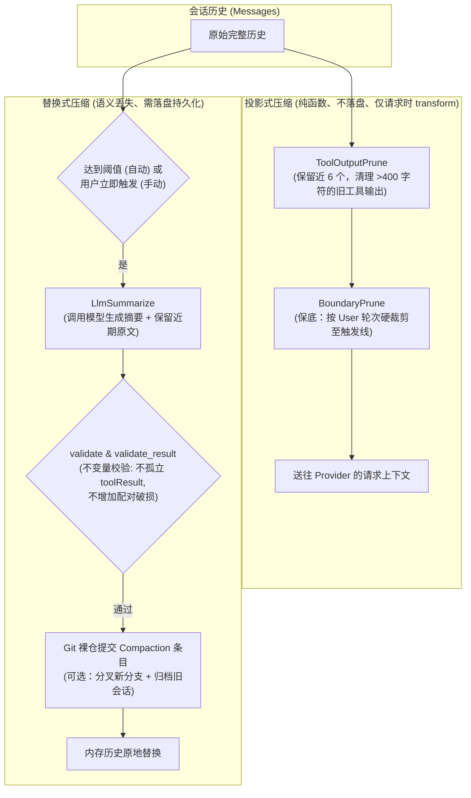
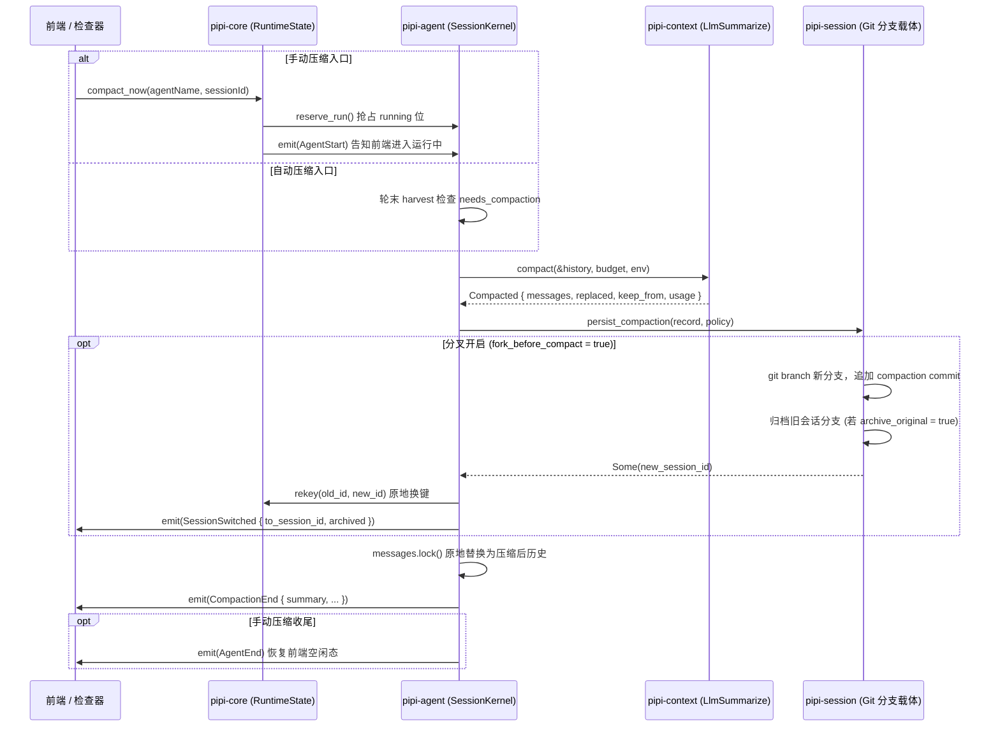

# 06 - 上下文压缩体系规范：静态管线、阈值预算与会话分叉

> **状态**：生效中  
> **所属层级**：`crates/pipi-context`（策略与预算）/ `crates/pipi-agent`（编排与持久化）/ `crates/pipi-core`（手动装配）  
> **权威实现**：  
> - `crates/pipi-context/src/compaction/mod.rs`（`Budget`, `Plan`, `validate`, `validate_result`, `project`, `compact`）  
> - `crates/pipi-context/src/compaction/tool_output.rs`（`ToolOutputPrune`）  
> - `crates/pipi-context/src/compaction/llm.rs`（`LlmSummarize`）  
> - `crates/pipi-agent/src/session/compaction.rs`（`run_compaction`, `persist_compaction`）  
> - `crates/pipi-core/src/runtime/compaction.rs`（`compact_now`）  
> **前置规范**：`01-workspace-architecture.md`, `03-git-session-carrier.md`

---

## 1. 背景与设计哲学

在长期对话与重度开发场景下，模型上下文窗口（Context Window）极易被大量的对话轮次与冗长的工具输出（如大段读取、搜索结果）耗尽。若不做控制，会导致模型产生 400 上下文超限报错、推理成本急剧上升以及注意力分散。

Pipi 的上下文压缩体系确立了三项基础设计哲学：
1. **纯函数决策与改写解耦**：压缩策略仅读取只读历史，输出改写计划（`Plan`），绝不直接修改内存中的会话历史；
2. **两类压缩严格物理隔离**：确定性、可重算的逻辑作为「投影式」，绝不落盘；只有发生信息丢失的语义摘要才作为「替换式」持久化落盘；
3. **静态具象顺序取代动态对象**：废除无意义的 `dyn Trait` 插件机制，采用硬编码、确定性、成本递增的具象调用顺序。



---

## 2. 两类压缩体系划分

根据「是否可从原始历史无损重算」，Pipi 将压缩严格划分为两条正交路径：

| 维度 | 投影式压缩 (Projection) | 替换式压缩 (Replacement) |
| :--- | :--- | :--- |
| **持久化行为** | **绝不落盘**（纯内存、纯函数、幂等） | **必须落盘**（在 Git 会话载体上写入 Compaction 条目） |
| **调用时机** | 每次向模型组装请求上下文时（`transform_context`） | 轮末自动触发或用户手动点击「立即压缩」 |
| **状态回放一致性** | 重新加载会话时由相同逻辑重算，live 与重开完全一致 | 回放账本时遇到 Compaction 条目重建历史 |
| **核心档位** | `ToolOutputPrune`、`BoundaryPrune` | `LlmSummarize` |
| **计算开销** | 极低（纯字符串与列表操作，无网络请求） | 较高（需消耗一次 LLM 摘要调用生成文本） |

### 2.1 投影式策略（Projection）
1. **`ToolOutputPrune`（旧工具输出清理）**：
   - 规则：保留最近 `TOOL_OUTPUT_KEEP = 6` 个工具调用的完整输出；对于更早的工具输出，若长度超过 `TOOL_OUTPUT_MIN_CHARS = 400` 字符，则将其内容替换为清理提示占位符。
   - 收益：在不改变对话轮次结构、不损坏协议配对、不发起 LLM 调用的前提下，快速释放大量无用的详细输出 token。
2. **`BoundaryPrune`（边界硬裁剪保底）**：
   - 规则：当上下文即使经过清理仍超出触发预算时，以完整的 User 轮次为边界，直接丢弃最旧的若干完整轮次，裁剪到 `trigger_tokens()` 之内。

### 2.2 替换式策略（Replacement）
- **`LlmSummarize`（语义摘要与尾部保留）**：
  - 提取被压缩历史中的关键事实、决策以及涉及的文件操作（自动汇总 `read`、`write`、`edit` 的文件列表）；
  - 调用模型生成 Markdown 格式的结构化摘要，首尾包裹 `<compaction summary>...</compaction summary>` 并伪装为第一条 User 消息；
  - 根据保留预算 `keep_budget`，从完整的 User 轮次边界切断，保留最近的数轮原文紧随摘要之后；
  - 若历史第一条已是旧摘要，摘要提示词会注入 `previous_summary`，防止信息在多次压缩后逐级漂移。

---

## 3. 静态化具象顺序调用

在早期架构中曾使用动态的 `dyn Projection` 和 `dyn Replacement` 特征对象流水线。实证表明：全仓只有上述三个具象策略，引入动态派发带来了虚假的可扩展性，且让调试与追踪变得极其晦涩。

当前架构已完全静态化为**确定性顺序调用**：
```rust
// 投影式流水线：crates/pipi-context/src/compaction/mod.rs
pub fn project(messages: Vec<Message>, budget: Budget) -> Vec<Message> {
    if budget.context_window == 0 {
        return messages;
    }
    // 1. 成本最低：先清旧工具输出
    let current = apply_projection(messages, budget, ToolOutputPrune::NAME, |prep| {
        ToolOutputPrune.applies(prep).then(|| ToolOutputPrune.plan(prep))
    });
    // 2. 兜底保护：仍超预算才进行轮次硬截断
    apply_projection(current, budget, BoundaryPrune::NAME, |prep| {
        BoundaryPrune.applies(prep).then(|| BoundaryPrune.plan(prep))
    })
}
```
新增任何一档压缩策略，只需编写一个具象模块，并在入口显式增加一行调用，彻底消除动态流水线与对象包装开销。

---

## 4. 触发机制与预算计算模型

所有压缩算法的阈值与预算统一收敛于 `pipi_context::compaction::Budget`，**禁止在外部自行编写第二套判断逻辑**：

### 4.1 自动压缩触发线 (`trigger_tokens`)
$$\text{trigger\_tokens} = \frac{\text{context\_window} \times \text{compactThresholdPercent}}{100}$$
- `context_window == 0` 时整体禁用自动压缩；
- `compactThresholdPercent`：Agent 级配置项（在 `agent.json` 中配置，合法范围 `1..=100`，默认值为 **75**）；
- 越界配置由 `normalize_threshold_percent` 自动回退为 75%，保证系统健壮性。

### 4.2 保留尾部预算计算 (`keep_budget`)
为了确保摘要生成后，近期上下文仍具备连续性，系统为近期完整轮次预留预算：
1. 预留模型回复空间：`DEFAULT_RESERVE_TOKENS = 16,384`；
2. 摘要输出空间：`summary_max` 在小窗口下按可用空间的 1/4 计算，并在 `[1024, 13107]` 间夹取；
3. 保留尾部基准：
   $$\text{max\_tail\_budget} = \text{trigger\_tokens} - \text{reserve} - (2 \times \text{summary\_max})$$
4. 最终保留预算：`keep_budget = min(max_tail_budget, KEEP_RECENT_TOKENS)`（默认 `KEEP_RECENT_TOKENS = 20,000`）；
5. 可选目标百分比：若 Agent 声明了 `compactTargetPercent`（如 50%），则以压缩前估算 token 乘以目标百分比推算目标。

---

## 5. 自动与手动压缩的统一编排

无论是轮末自动触发，还是用户在 UI 点击「立即压缩」，均在内核中走同一套编排函数：`pipi_agent::session::compaction::run_compaction`。



### 5.1 手动压缩的关键生命周期不变量
- **必须补发一对 `AgentStart` / `AgentEnd`**：前端状态机的 `running` 位由 `compaction_start` 置为 true，但只有 `agent_end` 会重置为 false。若不补发 `AgentStart/AgentEnd`，手动压缩会导致 UI 永久卡死在「运行中」（无法切换模型、无法发消息）。
- **跳过阈值预检**：手动压缩允许在未达 75% 阈值时强制执行，但若会话轮次过短导致无可切轮次，策略会抛出清晰的可读错误（如「空上下文无需压缩」或「尚未超出保留预算」），直接展示于前端。

### 5.2 分叉与归档机制 (`CompactionPolicy`)
依据全局 `settings.json` 的 `compaction` 段配置：
- **分叉开启 (`forkBeforeCompact: true`)**：
  1. 在 `sessions.git` 中基于当前分支活跃 commit 创建全新分支（生成新的 `sessionId`）；
  2. 在新分支上追加 Compaction 增量提交；
  3. 关闭旧分支句柄，原地将运行槽内的 `session.writer` 替换为新分支写入器；
  4. 触发 `rekey` 钩子，将宿主运行时槽内的键从 `(agentName, old_id)` 迁移到 `(agentName, new_id)`，**确保停止按钮与 Steering 管道不中断**；
  5. 派发 `SessionSwitched` 事件，前端平滑迁移视图；
  6. 若 `archiveOriginal: true`，将原会话分支移入归档命名空间。
- **分叉关闭或失败回退**：直接在当前会话分支追加 Compaction 增量提交。

---

## 6. 不变量校验体系 (Fail-Closed)

压缩计划在被应用至内存历史之前，必须无例外通过两道静态校验门禁（`validate` 与 `validate_result`）：

### 6.1 计划结构合法性 (`validate`)
1. **改写与保留互斥**：就地改写（`rewrites`）不得与切断保留（`keep_from`）或摘要注入（`injections`）同时存在，防止下标错位；
2. **角色一致性**：就地改写替换消息时，替换前后消息的 `role()` 必须完全一致，严禁跨角色窜改；
3. **保留起点不得孤立 `toolResult`**：
   ```rust
   if let Some(first) = messages.get(start) && first.role() == "toolResult" {
       return Err("保留起点落在工具结果上：会孤立 toolResult".into());
   }
   ```
   保留段的第一条绝对不能是工具执行结果。因为该结果对应的助手 `tool_call` 已被截断在摘要之前，发送给下游模型会导致协议校验失败直接报错。

### 6.2 配对破损度不增加 (`validate_result`)
压缩后的历史不得比压缩前的历史**更破损**：
- **无主调用数**：历史中存在 `tool_call` 但找不到对应 `tool_result` 的数量；
- **孤儿结果数**：历史中存在 `tool_result` 但找不到对应 `tool_call` 的数量；
- **判据**：若压缩后两项指标的任何一项高于压缩前，立即判定计划非法（Fail-Closed），放弃本次压缩，保证模型 Wire 协议的绝对安全。

---

## 7. 架构代码映射与测试套件

### 7.1 代码落点
- `crates/pipi-context/src/compaction/mod.rs`：`Budget`, `Preparation`, `StrategyEnv`, `Plan`, `validate`, `validate_result`, `project`, `compact`, `needs_compaction`；
- `crates/pipi-context/src/compaction/tool_output.rs`：`ToolOutputPrune` 实现；
- `crates/pipi-context/src/compaction/llm.rs`：`LlmSummarize` 提示词组装、LLM 请求与解析；
- `crates/pipi-agent/src/session/compaction.rs`：`run_compaction`, `persist_compaction`, `keep_from_entry_id`；
- `crates/pipi-agent/src/session/run.rs`：`prepare_compaction`, 手动压缩时的 `AgentStart`/`AgentEnd` 包装；
- `crates/pipi-core/src/runtime/compaction.rs`：宿主层 `compact_now` 调度入口与槽检查。

### 7.2 测试验证套件
1. **压缩语料不变量回归**：`crates/pipi-context/tests/compaction_corpus.rs`（针对真实长会话与极端合成语料，验证工具配对、轮次边界、空上下文与极端小窗口下的稳健性）；
2. **百分比预算单测**：`crates/pipi-context/src/compaction/mod.rs` 内联单测验证阈值计算、越界归一化、保留预算算术；
3. **分叉与状态机集成测试**：`crates/pipi-core/tests/compaction_runtime.rs` 验证手动压缩在未达阈值时的成功分叉、事件流序列（`AgentStart` -> `CompactionStart` -> `SessionSwitched` -> `CompactionEnd` -> `AgentEnd`）以及结束后 `session_running == false`。
